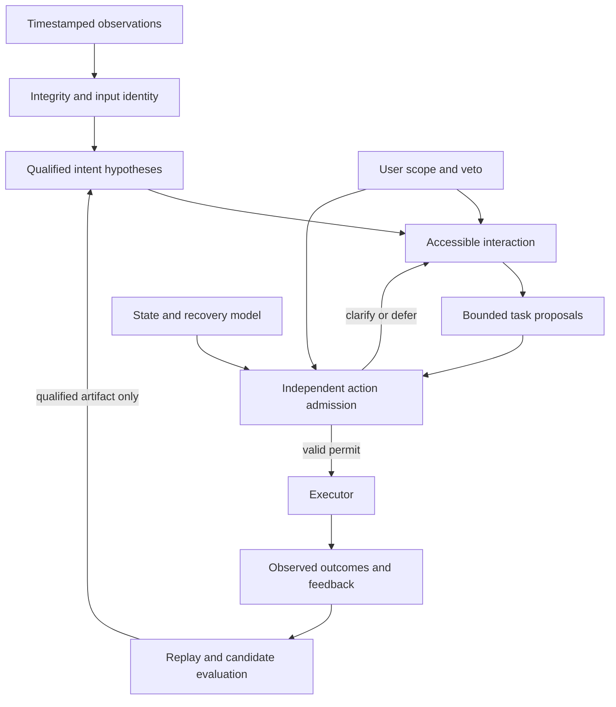

> Historical design snapshot. The executable 2.0.0 implementation and remaining gaps
> are documented in [docs/V2_IMPLEMENTED.md](../V2_IMPLEMENTED.md).
> Design-check scripts mentioned below are retained as text in `docs/history/preimplementation/`; use
> `python -m scripts.validate_release` for current executable validation.

# SynapDrive-AI v2 update design

**Design date: 2 November 2026. Status: proposed architecture and implementation specification.**

This document records the design prepared before the executable 2.0.0 release.
At that point the runtime was v1.0.0, and this document specified proposed work.
Its design checks evaluated specification consistency and a bounded admission model.
For the current implemented behavior, measured results and remaining gaps, use
[the implementation record](../V2_IMPLEMENTED.md) and [results](../../RESULTS.md).

## Purpose and ambition

Evolve SynapDrive-AI into a usable, inspectable neuroadaptive shared-autonomy research system that helps preserve communication and computer access as inputs, decoding validity, user preferences and operating conditions change. Retain a second, explicitly simulated control environment for testing dynamics-aware assistance and recovery.

The principal outcome is meaningful activity completed with reliable user control and acceptable effort. Decoder accuracy, a signed ledger, or a large test count is insufficient on its own. The architecture combines useful assistance, explicit non-control states, bounded actuation, adaptation qualification, privacy and recoverability rather than assuming that one better neural network solves the complete problem.

The design addresses access continuity, input integrity, user control, adaptation and reproducible evaluation. It targets problems software can directly address, and creates explicit interfaces and evidence gates for problems that also require sensors, hardware, participants, funding or clinical support.

## Read this design

- [Research and pain-point traceability](preimplementation/RESEARCH.md): 27 primary/official sources, 15 prioritized problems, evidence limits and proposed responses.
- [Architecture](preimplementation/ARCHITECTURE.md): contracts, state transitions, assistance, adaptation, recovery, privacy and concurrency.
- [Validation protocol](preimplementation/VALIDATION.md): real-data protocols, independent simulators, fault combinations, participant evaluation and release decisions.
- [Implementation sequence](preimplementation/IMPLEMENTATION.md): concrete code destinations, dependencies, deliverables and exit gates.
- [Design verification](preimplementation/DESIGN_VERIFICATION.md) and [requirement traceability](preimplementation/TRACEABILITY.md).
- [Baseline audit](preimplementation/BASELINE_AUDIT.md): reproduced defects in the original v1 archive and the diagnostic script.
- [Machine-readable requirements](preimplementation/requirements.json), [acceptance cases](preimplementation/acceptance_tests.json), [experiments](preimplementation/experiments.json), and [operating profiles](preimplementation/profiles.json).

All paths described as planned in these documents are future implementation destinations. Their presence in a module catalog is not evidence that the corresponding code exists.

## Critical problems integrated into the update

| Problem | Integrated response | Evidence needed |
| --- | --- | --- |
| Access disappears on a difficult day | Qualified alternate inputs, explicit degradation, retained task state and guided recovery | Longitudinal usable access and recovery burden |
| The user intends no command | No-command state, engagement, sequential evidence and consequence-sensitive confirmation | Idle false activations, missed commands and delay |
| Session/device/montage/processing changes | Full acquisition identity, qualification expiry and dependency invalidation | Held-out-session and mismatch experiments |
| Bad or stale signals look confident | Per-channel exclusions, qualified subsets, clocks, gaps and age bounds | Independent fault oracles and timing measurements |
| Setup and maintenance overwhelm benefit | Accessible preflight, portable preferences, local operation and support/export design | User/caregiver setup, failed-start and support measurements |
| Assistance changes the person's goal or words | User-selected scope, original hypotheses, proposal/approval separation and exact output binding | Wrong-goal commitments, corrections and perceived control |
| Two learners destabilize each other | Separate control/adaptation timescales, shadow candidates and rollback | Chronological adaptation and co-adaptation experiments |
| Fallback cannot stop the current plant | State-dependent baseline controller, recovery envelope and deadline-aware switching | Independent plant simulation, then hardware evidence |
| Feedback or crashes corrupt history | Versioned capsules, delayed-feedback correction, prepared dispatch records and uncertain-outcome reconciliation | Interrupted-cycle and replay experiments |
| Benchmarks overstate generalization | Grouped splits, parent-trial identity, locked audit data and modality/cohort limits | Leakage and label-permutation controls; clustered intervals |
| Private signals or content escape | Privacy lock, explicit capture/output/export controls and limited retention | Process-boundary and export inspection; no broad mind-reading claim |
| A worker, model or data path is compromised | Bounded IPC, enforced isolation where available, artifact identity and independent executor credentials | Declared threat-model tests |
| Models exhaust local resources | Compact qualified baseline, deadlines, cancellation and bounded queues | Declared-hardware resource measurements |
| Abilities, preferences and dependencies evolve | Versioned user profiles, requalification, service-loss recovery and migration | Longitudinal adaptation/support evidence |
| Software claims exceed evidence | Separate design, software, offline, simulation, hardware, human and deployment evidence | Release gates that remain blocked when evidence is absent |

Priorities are qualitative engineering judgments about consequence, user impact and tractable intervention. They do not estimate prevalence or establish a global ranking.

## The system to build



The proposal path may use advanced models. Action authority remains with the admission/execution contract. Assistance may be substantial when the user selected that scope and the operating profile supports it. Low automation is not automatically more respectful or useful. Every scope retains an accessible way to pause, reject or revise behavior, subject to the actual input methods available to that person.

## First useful application and second research environment

**Accessible communication and computer tasks:** begin with a local research workspace for selection, text composition/correction, navigation and explicitly confirmed output to a simulated endpoint. Support declared/switch/gaze/EMG/EEG adapters only when their contracts and available evidence warrant them. A motor-imagery class must not be presented as decoded free-form speech. A phrase-bank demonstration must be labeled as phrase selection. A synthetic waveform is a software fixture.

The future pilot compares the new system with the person's existing access method. EEG is optional when another input is more useful. A fallback input must be available, usable and qualified for the relevant task before it can be offered.

**Independent dynamics-aware simulation:** a bounded mobility/cursor environment exposes state, dynamics, obstacles, delays, uncertainty and failure acknowledgments separately from the controller. It tests whether assistance and baseline control preserve specified constraints while accomplishing tasks. Physical hardware remains a separate integration program with independent limits, timing measurements and safety evidence.

## Advanced work that is justified as experiments

1. **Hypothesis-compatible progress:** compare asking, waiting and a reversible initial step compatible with every retained supported goal. Reject when the intersection of authorized safe actions is empty. Evaluate the value of the retained hypothesis set under shift; a conformal set does not automatically remain valid.
2. **Qualification dependency invalidation:** changes in a decoder, montage, processing graph, action map, policy, permission or task state invalidate dependent authority. This addresses failures that model confidence cannot detect.
3. **Controlled multi-timescale adaptation:** compare frozen, supervised, alignment-based and forward-pass transformation approaches; maintain shadow and rollback paths. Do not use the system's own successful action as proof of intended meaning.
4. **Assistance-aware communication evidence:** preserve decoder support, language-prior influence, revisions and exact approved output. Computational attribution is a diagnostic, not proof of mental authorship.
5. **Minimal failure reproductions:** reduce a combined-fault run to a small replayable scenario while keeping the violated requirement and independent oracle intact.

These are research directions assembled from credited prior work and the repository audit. No foundational algorithm is claimed as an original invention, and no advantage is claimed before comparison with appropriate baselines.

## Work boundaries

| Direct software work | Requires additional evidence or partners |
| --- | --- |
| Contracts, decoder adapters, data evaluation, local interaction, simulated assistance, artifact lifecycle and replay | Actual user goals, acceptability and benefit require participation from intended users and caregivers |
| Signal-integrity and drift checks | Electrode quality, implant longevity, tissue response and sensor availability also depend on hardware/biology |
| Bounded simulated recovery and deadline enforcement | Real braking, manipulation, actuator failures and worst-case hardware timing require hardware-specific validation |
| Local privacy controls and isolated-worker design | Privileged-host compromise, external backups and upstream device capture exceed the basic process boundary |
| Resource-aware models and offline continuity | Manufacturing cost, reliable long-term service and clinical availability cannot be established by repository code |

The initial profiles permit local simulated endpoints or live shadow observation only. Digital pilot and physical profiles have empty endpoint allowlists until their explicit gates are met. The runtime's research status must not be converted into a medical, clinical, or safe-physical-control claim.

## Implementation order

| Stage | Deliverable | Exit condition |
| --- | --- | --- |
| R0 | This integrated design and checked reference protocol | Traceability and bounded-model checks pass; runtime readiness remains false |
| R1 | Repair existing enforcement, replay, stop, permission, plan and session-loop defects | Reproductions become behavioral regressions; all original functionality and failure invariants are checked |
| R2 | Grouped real-data science and exact artifact qualification | Real datasets, permitted splits, calibration and negative controls produce reproducible reports |
| R3 | Accessible local tasks, qualified input transition and independent control simulation | Useful tasks and recovery compared at matched constraints; external writes remain separately gated |
| R4 | Controlled adaptation, isolation, privacy and robustness experiments | Independent promotion/rollback and failure evidence; no unsupported semantic or security claims |
| R5 | Intended-user/caregiver co-design and approved pilots | Meaningful comparison with existing access, individual burden/control metrics and disclosed failures |
| R6 | Hardware-specific and longitudinal deployment programs | Measured timing, plant safety, sustained benefit, support and continuation evidence |

An implementation stage is not complete because a corresponding document or empty module was created. Every requirement remains `planned` and every runtime acceptance case remains `not_run` in this design package. Six application-dependent parameter decisions are deliberately unresolved and block relevant release gates. They are listed in `profiles.json`; accuracy, latency and clinical targets require application-specific evidence.

## Executable design checks

```bash
python scripts/validate_v2_design.py
python scripts/check_v2_admission_model.py
python scripts/validate_v2_design.py --strict-release
```

The first command checks cross-references, source/date/status fields, coverage of the audited defects and problems, and baseline integrity against recorded publication edits. The second exhaustively explores a **bounded abstract protocol**, including deliberately broken guard variants. Its exact scope and state counts are in the generated report. The third command must fail for this package because the proposed runtime, experiments and release parameters are unfinished. That refusal is intentional and must not be bypassed to label the update ready.

The original archive identity and file hashes remain recorded in `docs/history/preimplementation/baseline.json`, alongside the publication edits. Local release records and `RELEASE_MANIFEST.sha256` are regenerated for this package. The manifest covers every packaged file except itself; it establishes file integrity, not runtime behavior, scientific validity or remote CI success.

